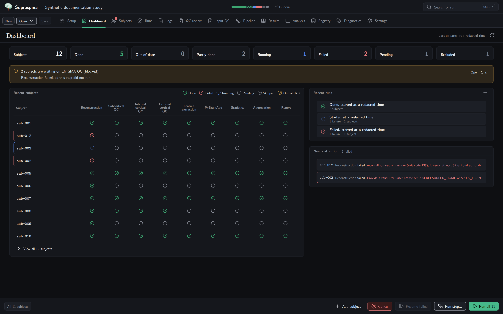

# Supraspina

Supraspina is a Linux desktop console for research teams that operate a 14-stage
structural-MRI workflow. The Electron application configures projects, shows
QC and cohort state, and supervises a separate, bundled Python sidecar process.
The sidecar launches the selected scientific tools and records plans, logs,
receipts, and artifact evidence.

The stages are Brain FOV preparation, optional defacing, reconstruction, ENIGMA
QC, histogram and outlier review, FreeSurfer feature extraction, age metadata
integration, PyBrainAge prediction, clinical merge, Brain-PAD statistics,
structural data aggregation, R analysis, BrainCharts normative modeling,
and z-score group comparisons. Defacing, BrainCharts normative modeling, and
z-score group comparisons are off by default.

Supraspina is research software. It is not a medical device and does not provide
diagnosis, treatment recommendations, clinical decisions, or validation for
patient care. Operators remain responsible for data governance, scientific
method choices, QC decisions, and interpretation.

The capture comes from a deterministic synthetic study and contains no real
participant or patient data. [Documentation
screenshots](docs/development.md#documentation-screenshots) describes how the
set is made.

## Install on Linux

Supraspina runs on Ubuntu 22.04 and 24.04 x86_64, natively or inside an Ubuntu
WSL2 distribution with WSLg. There is no Windows or macOS application. Download
the AppImage or deb package from [GitHub
Releases](https://github.com/qwareeq8/supraspina/releases) and follow
[Installation](docs/installation.md) to verify and install it; Installation also
covers releases that carry source only. Version numbers are explained in
[Release identity](docs/releasing.md#release-identity).

The package includes the Python sidecar, so no host Python is needed to run the
application. The scientific stages need their own external tools and licenses,
such as FreeSurfer or FastSurfer through Apptainer, MATLAB or MATLAB Runtime, R,
and the separately provisioned PyBrainAge and BrainCharts environments. After
installing, run Diagnostics to see what the enabled stages require.

## Minimal workflow

1. Create a project and select a raw-data directory containing one unambiguous
   3D T1-weighted NIfTI file per selected subject.
2. Configure separate writable derivatives and output directories plus any
   age, clinical, model, license, or tool paths required by enabled stages.
3. Save `supraspina.project.json`, run Diagnostics, and resolve blocking checks.
4. Review Brain FOV preparations in Input QC and later ENIGMA galleries at the
   required human-review gates.
5. Review the dry-run plan and subject scope. To execute, turn off Dry run and
   save, then turn on Allow live runs to authorize that exact plan.
6. Monitor Runs and Logs, then inspect receipt-bound artifacts in Results.

Supraspina never writes prepared images into the raw-data directory and never
silently restarts interrupted scientific work. See the [operator
guide](docs/user-guide.md) for project layout, recovery, and error handling.

## Inputs, outputs, and limits

The primary image input is one scalar 3D T1 NIfTI volume per subject. Later
stages can also require age and clinical tables, FreeSurfer derivatives, a
FreeSurfer license, and pinned model resources. Outputs include prepared T1
derivatives, reconstruction directories, QC tables and galleries, feature and
brain-age tables, statistical CSV or workbook files, figures, and an optional
HTML report. Durable run state lives under the project `.supraspina/` directory.

File and receipt checks establish software contracts and provenance. They do
not establish anatomical correctness, successful de-identification, model
validity for a population, statistical validity, or clinical suitability.
[Science](docs/science.md) documents the methods, the fixed cohort and output
assumptions, and the behavior with sparse cohorts.

## Develop

[Development](docs/development.md) covers the source setup, the scientific
asset download that a checkout needs, and the [source
gate](docs/development.md#source-verification) that every change passes.

## Documentation

| Document                             | Audience and scope                                                         |
| ------------------------------------ | -------------------------------------------------------------------------- |
| [Installation](docs/installation.md) | Linux packages, WSL2, external tools, and managed resources                |
| [Operator guide](docs/user-guide.md) | Projects, QC, plans, runs, results, recovery, and troubleshooting          |
| [Science](docs/science.md)           | Stage methods, units, outputs, atlases, review boundaries, and limitations |
| [Architecture](docs/architecture.md) | Electron and sidecar boundaries, RPC, persistence, and shutdown            |
| [Development](docs/development.md)   | Source setup, tests, source verification, screenshots, and change practice |
| [Releasing](docs/releasing.md)       | Maintainer-only Linux build, package acceptance, and publication           |

The analysis code of the dorsal medulla paper is in [`analyses/`](analyses/README.md).

## Credits, citation, and license

Supraspina is developed by Yusuf Qwareeq ([qwareeq.com](https://qwareeq.com/),
[yusuf@qwareeq.com](mailto:yusuf@qwareeq.com)). Thank you to Oscar Ortiz Angulo
and Ryan Loke for [SCI_Map](https://github.com/ortizo-117/SCI_Map), the
structural-MRI pipeline Supraspina builds on. The icon is adapted from Patrick
J. Lynch and C. Carl Jaffe's
[brain stem illustration](https://commons.wikimedia.org/wiki/File:Brain_stem_normal_human.svg)
(CC BY 2.5).

The scientific baseline is SCI_Map at pinned commit
[`8a8c2d3`](https://github.com/ortizo-117/SCI_Map/tree/8a8c2d3586a37bb896bd8bdc3743b43e602827e3).
Neither SCI_Map nor the ENIGMA QC protocol it includes has a license, so this
repository and its packages contain none of their files; Supraspina downloads
them from that commit at run time. Cite Supraspina with
[`CITATION.cff`](CITATION.cff); Zenodo archives every release under
[doi:10.5281/zenodo.24451026](https://doi.org/10.5281/zenodo.24451026), which
lists the DOI of each version. Cite SCI_Map when its methods or outputs
support the work. BrainCharts z-scores also require citing Rutherford et al.
2022, eLife 11:e72904 (doi:10.7554/eLife.72904). The BrainCharts model and
pcntoolkit are GPL-3.0, and the operator downloads them from their official
source, so Supraspina never bundles them.

First-party Supraspina code is under the [MIT License](LICENSE). That license does
not relicense upstream scientific assets, models, fonts, containers, or other
dependencies. Review [`THIRD_PARTY_NOTICES`](THIRD_PARTY_NOTICES) and the
file-level [`THIRD_PARTY_PROVENANCE.json`](THIRD_PARTY_PROVENANCE.json) before
redistribution.
