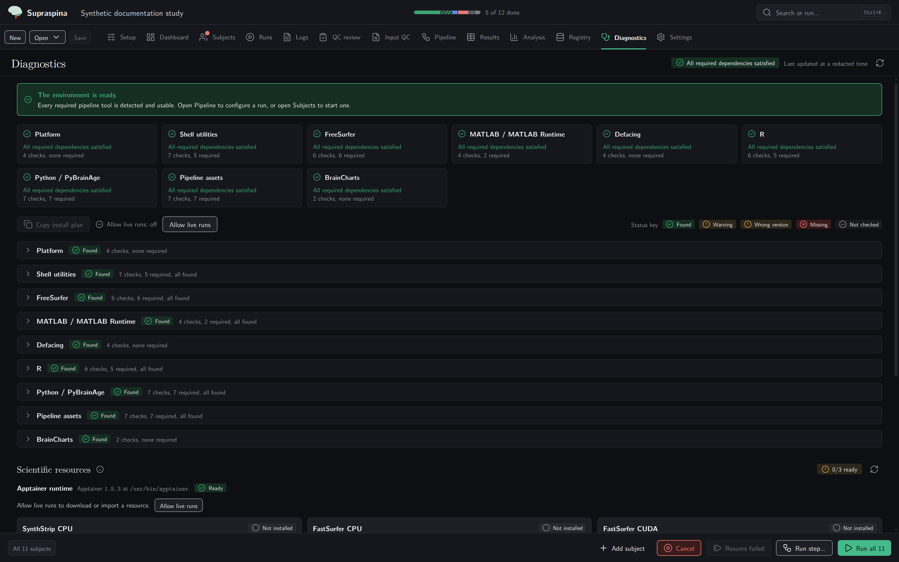
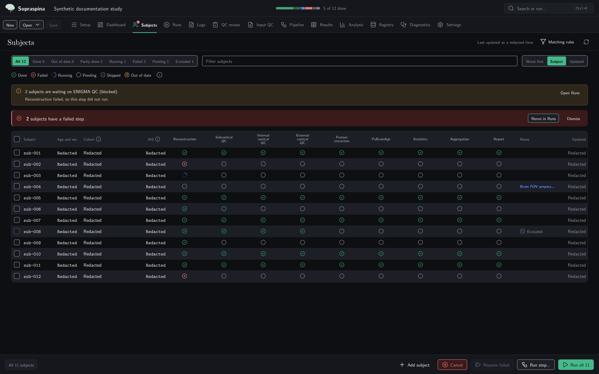
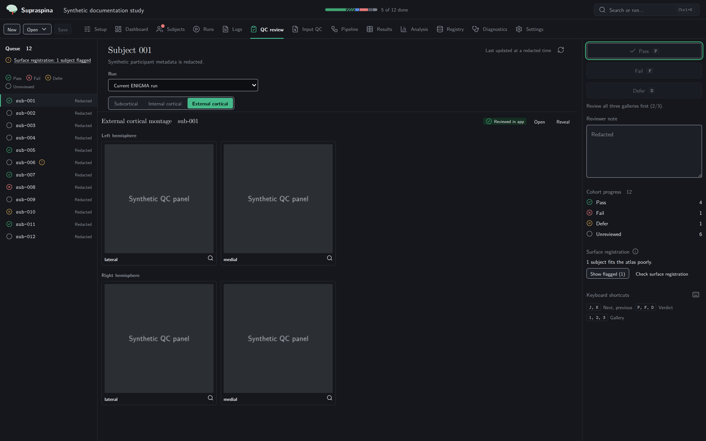
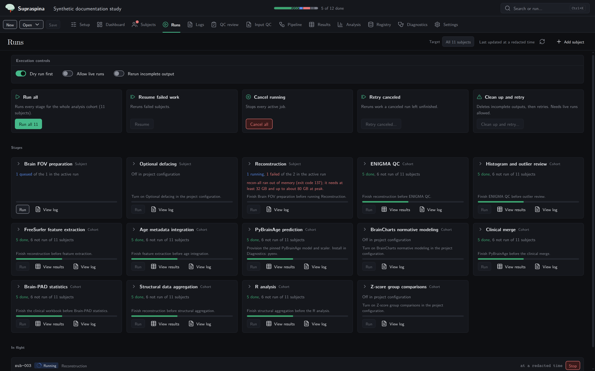
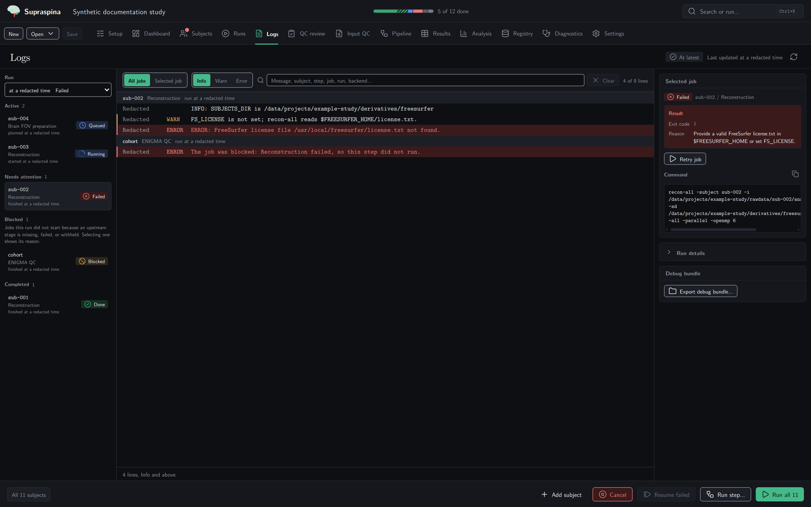
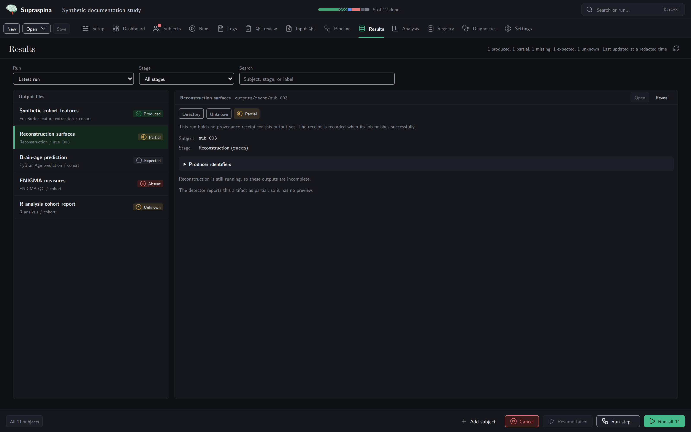
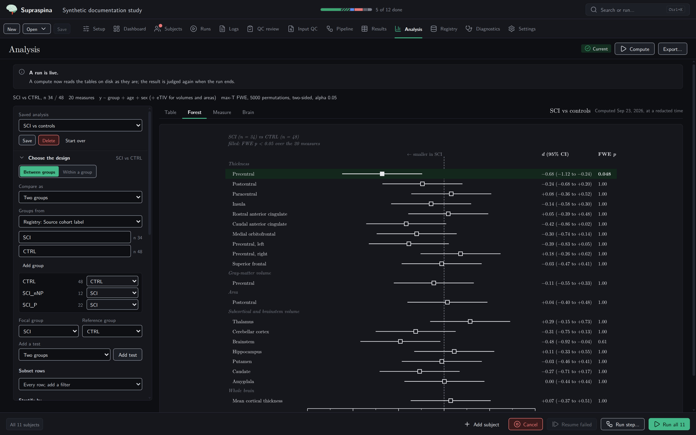
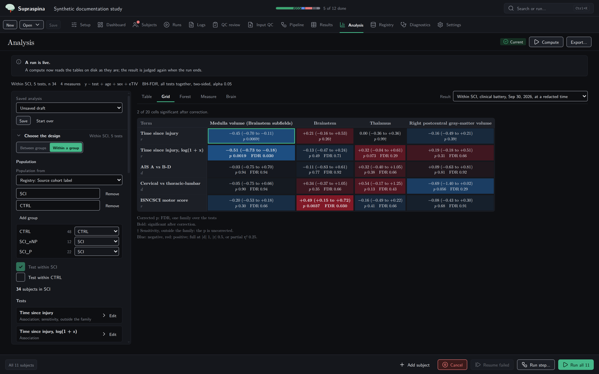

# Operator guide

Supraspina turns one saved project configuration into reviewed plans and
receipt-bound research outputs. Draft edits in the window can feed limited
Diagnostics and subject discovery, but provisioning, Input QC, planning, and
execution use only the exact saved `supraspina.project.json` revision.

## Create a project

Choose a project root and configure separate locations for raw inputs,
derivatives, workflow outputs, and metadata. Supraspina writes the project file
at the project root and durable application state below `.supraspina/`.
Display preferences are stored per machine in Electron's user-data directory,
not in the project configuration.

A typical subject layout is:

```text
rawdata/
  sub-001/
    anat/
      sub-001_T1w.nii.gz
  sub-002/
    anat/
      sub-002_T1w.nii.gz
```

### Subject discovery

Discovery applies the configured subject glob, then looks for the T1 pattern at
the subject root, below `anat/`, and recursively below the subject. The T1
pattern matches letters regardless of case, so `*t1*.nii*` also finds
`sub-01_T1w.nii.gz`. A subject folder or T1 file may be a symbolic link inside
the raw root; discovery follows it and records the target as the input. Both
patterns are set in the Setup wizard and can be changed later with Matching
rules on the Subjects toolbar, which saves the project and rediscovers the
cohort. A pattern is one folder or file name pattern without slashes, `..`, or
control characters.

Each selected subject must resolve to exactly one regular file. A missing,
ambiguous, unsafe, or escaping match blocks planning. A T1 whose name does not
follow BIDS (`<subject>_T1w.nii.gz`) is accepted, and its Brain FOV derivatives
are named after the discovered subject ID. Discovery is pattern-based; it is
not BIDS validation. Discovery computes a full SHA-256 fingerprint of each
input.

The wizard's Data step holds two optional lists: Subjects to run
(`subjects.include`; empty means every match) and Subjects to exclude
(`subjects.exclude`). An excluded subject leaves the Subjects screen, every
run, and the analysis cohort, and Registry lists it as excluded by project
configuration. An ID cannot be in both lists; if a hand-edited file lists it in
both, the exclusion wins.

A project file must list every pipeline stage and only the keys of the current
schema. Supraspina rejects a file with a missing stage or an unknown key and
names the key to fix.

### Directory rules

The output directory must not overlap the raw-data directory, and the raw-data
directory must not name or contain the project root. Supraspina refuses to save
a colliding configuration and names both fields. Use absolute paths. Brain FOV
preparation and defacing publish derivatives; Supraspina never writes into the
raw-data directory.

## Track progress on the Dashboard

The Dashboard summarizes the open project and starts no scientific work.

The count band reports Subjects, Done, Out of date, Partly done, Running,
Failed, and Pending; Interrupted and Canceled join it while some subject has an
interrupted or canceled step and none that failed. Excluded joins it while
some subject has a QC Fail verdict; such a subject counts there even with a
failed or running step. Each subject counts in exactly one set, the top-bar
cohort progress shows the same counts, and selecting a count opens Subjects
filtered to that set.

- Done means every enabled stage finished and is current. A stage turned off in
  the project configuration reads Skipped in the matrices, unless it has older
  output on disk, and no subject waits on it.
- Out of date means every stage finished but Run all would repeat at least one,
  and nothing failed, runs, or waits for that subject. A subject with a failed,
  interrupted, canceled, or unfinished step counts under that state instead,
  and the Out of date count states how many such subjects another count holds,
  for example "3 under Canceled".
- Partly done means at least one stage finished and at least one is still to
  run.

Failed, Interrupted, and Canceled count a subject by its own stages. A cohort
stage runs once for the whole analysis cohort, so when it fails, is
interrupted, or is canceled, its matrix cells show that outcome and its subjects
count as Partly done.

Two notices can appear below the counts, and Subjects shows them above its
matrix:

- A waiting notice names the cohort stage that finished subjects wait on, its
  latest outcome, and the recorded reason, for example "12 subjects finished
  their own stages; waiting on R analysis (blocked)." It also names a
  cohort stage that failed, was interrupted, or was canceled when no subject has
  finished its own stages. Open Runs opens the Runs screen to resolve it.
- An out-of-date notice names the finished cohort stages that Run all would
  repeat, how many subjects they cover, and what changed, for example after a
  QC Fail, a saved exclusion, a replaced T1 file, or a new subject. It also
  names an out-of-date cohort stage whose newest job did not finish.

Done and Out of date read `--` until Supraspina has checked which finished
stages are out of date, which happens once the workflow service is ready after
the project opens. Before that, discovery reads the cohort, which can take tens
of seconds for a large cohort, and the run controls show "Loading the
cohort...". They then show "Restoring run history..." while Supraspina settles
whether a run is still active, and the top bar reads "Workflow unverified".

Above the Subjects matrix, a banner counts the subjects with a failed,
interrupted, or canceled step. While a run waits for recovery it offers Resume
failed work, with the same rule as the run dock's Resume failed (see
[Recover a run](#recover-a-run)); otherwise it offers Retry in Runs or Rerun in
Runs.

### Matrices and lists

Recent subjects shows the latest subjects with their per-step status matrix;
selecting a subject opens it in QC review. A cell shows the outcome of the
newest job that ran that stage for that subject, in whichever run. In this
matrix and on the Subjects screen each state has its own shape as well as its
color: an hourglass for waiting, a circle with a bar for blocked, pause bars for
withheld, a circular arrow for out of date, and a question mark for an unknown
run state. The legend always lists Done, Failed, Running, Pending, Skipped, and
Out of date, and adds any other state a visible cell shows.

Recent runs names each run by its outcome and start time, for example "Failed,
started Sep 22, 2:17 PM", and its tooltip adds when it ended. A dry run reads
"Dry-run plan". A run with a stage whose state is unknown, went stale, or could
not be stored reads "Unknown", "Stale", or "Storage error", never Done. A
blocked run names the stages it blocked and those its failure policy withheld,
for example "Reconstruction blocked; ENIGMA QC withheld". Selecting a run opens
Logs on it. When the run history cannot be read, the panel says so and offers
Retry, because the history is then unknown rather than empty.

Needs attention lists the subjects with a failed, interrupted, or canceled
step, failed first, with the step, its state, and its recorded reason. Refresh
project rediscovers the cohort and runs from disk.

## Configure enabled stages

The Pipeline and Setup views show stage dependencies and parameters. Depending
on the enabled stages, Supraspina needs:

- One scalar 3D T1 NIfTI volume per selected subject.
- A FreeSurfer installation and an operator-supplied license.
- Age metadata with configured subject-ID and age columns.
- The PyBrainAge model, scaler, and verified interpreter.
- Clinical metadata with the configured join key and required fields.
- An R analysis metadata file, `metadata.csv` in the metadata folder.
- The BrainCharts model and runtime, set up from Scientific resources.
- MATLAB or MATLAB Runtime, Rscript, Apptainer, and managed SIF resources.

[Packaged runtime and external tools](installation.md#packaged-runtime-and-external-tools)
lists the versions each stage accepts.

Save the project after every material change. When Save or Open... fails, a
row below the toolbar gives the reason; it clears on Dismiss, the next Save or
Open..., the next edit, or when another project opens. An advisory in the
Pipeline view appears on the stage whose parameters it concerns.

### R analysis metadata

R analysis reads `metadata.csv` from the metadata folder
(`paths.metadataDir`, `metadata/` under the project root by default).
Supraspina does not create this file, and the age and clinical CSV files do not
replace it. It needs a subject ID column named `participant_id`, `SubjectID`,
`Subject_ID`, `ID`, or `subject` and a cohort column named `Cohort`, `cohort`,
or `Group`. Optional `Sex`/`sex` and `Age`/`age` columns are read but not used
as covariates. Every analysis subject needs exactly one row.

For each run Supraspina writes a run-scoped copy that keeps only the analysis
subjects and takes their cohort and `Site` values from the registry, so the
file's own cohort and site columns do not decide group membership. When the file
is missing or unreadable, planning blocks R analysis with the expected path, and
the other stages still run.

### BrainCharts and z-score comparisons

BrainCharts normative modeling and Z-score group comparisons are off by
default; turn each on in the Pipeline view and save the project.

BrainCharts reads the FreeSurfer feature extraction output, so planning blocks
it unless that stage is on with `aparc.a2009s` thickness. It takes age, sex,
site, and cohort from the registry. Its one parameter, Adaptation split seed
(upstream 117), seeds the per-site split described in
[Normative modeling](science.md#normative-modeling-braincharts). With
BrainCharts on, its Pipeline card states which sites it adapts the model to and
which it refuses, and the top bar shows a BrainCharts chip until its model and
runtime are set up. The matrices show a BrainCharts column after PyBrainAge,
and a subject of a refused site reads skipped there.

Z-score group comparisons read the BrainCharts z-scores, so planning blocks them
unless BrainCharts is on or its outputs are complete. They run on the R analysis
interpreter. Their Render HTML report parameter is on by default and also
requires R Markdown, knitr, and Pandoc.

Set up the BrainCharts model and runtime in Diagnostics, under Scientific
resources, on the BrainCharts lifespan model card. Download first shows the
license notice: the GPL-3.0 statement, the repository NOTICE, the citation, and
the full license text. Accept and download fetches the model and its site and
phenotype lists, checks each file's size and SHA-256, and builds a runtime in
the project output directory; download and disk sizes are in
[PyBrainAge and BrainCharts](installation.md#pybrainage-and-braincharts). The
card shows progress and offers Cancel, then Recheck
BrainCharts once setup is ready. The runtime is available on Linux x86_64 only.

### Diagnostics



Run Diagnostics after saving and resolve its blocking checks. Every group
rollup, issue count, install plan, and readiness verdict covers only the checks
the saved pipeline configuration requires, which are the checks the run gate
enforces. A row no stage requires carries an "Optional" badge, and a row that
the current stage, backend, or tool choice excludes carries "Not needed for this
pipeline". Neither raises an issue. Each readiness tile and group header shows
how many of its checks the configuration requires.

Diagnostics also opens before a project exists, from the setup wizard's
Environment step, the command palette, or the digit shortcut. It then reports
host-level tools, project-scoped checks read "Not checked", and every repair
action waits for an open project with Allow live runs on.

The ENIGMA QC panel states the configured backend: the pinned `matlab` or
`mcr`, "auto (not checked yet)" before the first report, or the backend `auto`
resolved to. The MATLAB Runtime field names the root the check found, reads
"Detected (default location)" when no explicit root is set, and reads "Not
configured" only when no runtime was found.

A disabled Install, Rebuild, Set up, Download, or Import file... control states
what keeps it disabled, with the control that resolves it: Allow live runs
while that setting is off, and Save project while the project has unsaved
changes. Turning on Allow live runs is itself an unsaved change, so a save
follows it. An authorized install runs in the background, and its row reports
the installer, elapsed time, and output so far. Only one install runs at a time.
Diagnostics re-checks the environment after an install succeeds and keeps a
failed install on its row with the exit code and output.

The top-bar tool chips summarize the reconstruction backend (FreeSurfer or
FastSurfer), the QC backend, Analysis Python, PyBrainAge, and R packages. Each
reads the same checks the run gate enforces for the selected backend, and the
full bar draws a chip only for a tool that is missing or needs attention. The
compact tool count also covers the reviewed scientific assets that enabled
stages read, and a Scientific assets chip appears while they are missing or do
not verify. Chips open Diagnostics and start nothing.

### Rebuild the scientific assets

[Scientific assets](installation.md#scientific-assets) states which updates
keep the acquired scientific assets. After one that invalidates them, the
ENIGMA QC assets and stage asset rows report missing files that were never
deleted.

When every acquired file is still on the machine, Diagnostics shows a Rebuild
the scientific assets card below the recommended fix. It downloads nothing,
lists the checks the rebuild restores, and carries the Allow live runs and save
controls it needs. Rebuild assets, or Rebuild assets... on a Runs stage card
that the stale assets block, opens the authorization; the rebuild verifies
every file against the reviewed SHA-256, activates a new generation, and
re-checks the environment. When the card is absent and the Reviewed scientific
assets row offers Get it, a file no longer matches and the acquisition
downloads the pinned archive.

## Register subjects



Registry holds the operator-maintained cohort roles that the Clinical merge and
R analysis stages read. A record binds a subject ID to a source cohort label of Control,
No pain (SCI without pain), or Pain (SCI with pain), stored as `CTRL`,
`SCI_nNP`, or `SCI_P`, plus sex, age at scan, and optional AIS grade, years
since SCI, and site. A record is study bookkeeping, not a clinical
determination, and it never alters an image.

The age field may be empty when the age at scan is not recorded; the subject
still registers and runs, and its age reads as a dash. Lists show completed
years, while the record and the analyses keep the value as entered, such as
54.67. Registry shows the derived role, T1 availability, and recently
registered subjects. A record that cannot run reads Unavailable with each cause,
for example "Excluded from analysis: the QC verdict is Fail." Discovered
subjects that are not registered are listed beside the form, and selecting one
prefills the ID.

Register every analysis subject before the clinical merge or R analysis.
A missing or ambiguous role blocks those stages during planning rather than
guessing a group. An unregistered subject reads Not registered in the Subjects
matrix.

### Edit and remove records

Editing opens the form with the stored values and a fixed subject ID. A save
carries the revision the draft started from, so a record another writer changed
is rejected rather than overwritten; the draft is kept, and loading the saved
values shows them beside it so you can save over them or cancel. An edit keeps
the QC verdict, note, tags, and review evidence.

Remove asks for confirmation and deletes the record against the revision shown.
It deletes the stored fields and the registry's QC verdict, note, and tags; QC
review evidence, images, and pipeline outputs are untouched. A removed subject
that discovery still finds returns to the discovered list.

### Import a CSV file

The file must be UTF-8, at most 512 KiB, with a header row naming `subjectId`,
`age`, `sex`, and `sourceCohortLabel` and, optionally, `ais`, `tSinceSci`, and
`site`.

- `subjectId` is `sub-` followed by letters or digits.
- `age` is 0 to 130 years, or empty when not recorded.
- `sex` is `M`, `F`, or `O`.
- `sourceCohortLabel` is the stored token `CTRL`, `SCI_nNP`, or `SCI_P`. A
  display label such as `Pain` or `SCI, no pain` stores the ambiguous role with
  a warning on that row.
- `ais` is `A` through `D`, or empty.
- `tSinceSci` is 0 to 150 years, or empty.
- `site` is a site label, or empty to clear it.

Cohort roles are derived from `sourceCohortLabel`, so a file with a role or QC
column is rejected. The import is all-or-nothing: any error, including a
repeated subject ID, rejects the whole file. Before importing, choose whether
rows for registered subjects are skipped or update the stored records. Errors
and warnings name row numbers, counting the header as row 1, and the view can
save a valid example file.

### Sites

A site names the scanner and protocol a subject was scanned with; one center
with two scanners has two sites. A label is 1 to
64 letters, digits, spaces, periods, underscores, or hyphens, and a label that
differs from one in use only in letter case is refused.

The Registry summary counts the subjects of each site and states when only some
subjects have a site and when a site has no controls. Set site... selects
subjects, filterable by current site, and sets or clears their site in one
write. It also lists unregistered discovered subjects, because a site is a
scanner fact that can be known before age, sex, and cohort. Supraspina holds
that site until the subject is registered, and Register prefills it; planning
ignores a held site until then. An import file with a `site` column sets each
row's site; a file without it gives new subjects no site and leaves updated
subjects' sites unchanged. Once any subject has a site, Subjects adds a Site
column, a site filter, and Set site....

When no subject has a site, the project counts as one site. When only some do,
planning blocks R analysis, BrainCharts normative modeling, and Z-score
group comparisons and names the subjects without a site.
[Sites and scanners](science.md#sites-and-scanners) describes what each stage
does with sites.

## Complete human-review gates

Brain FOV preparation checks the physical field of view and, when needed,
publishes a mask-guided crop with QC evidence. Review each current publication
in Input QC. An acceptance authorizes that exact prepared derivative, and a
change to its image or evidence invalidates it. Reconstruction waits for each
subject's own approval, and its Runs card names the crops still waiting with a
link to Input QC.

After ENIGMA QC, review the subcortical, internal-cortical, and
external-cortical galleries. A `pass` keeps the subject in the analysis scope,
and a `fail` excludes it from downstream cohort analysis while keeping its
history and artifacts. `defer` and `unreviewed` subjects need explicit
acknowledgment: Run all and a cohort stage's Run ask for it with a checkbox in
their confirmation, and Resume or Retry asks after planning, offering Include
and re-plan or Exclude and continue. Per-subject stages (Brain FOV preparation,
defacing, and Reconstruction) do not read verdicts.

Neither gate establishes anatomical correctness or image suitability. A verdict
records operator acceptance for this analysis, not an automated finding.

## Review QC galleries



QC review shows the ENIGMA QC galleries one subject at a time. The queue selects
the subject, and the Subcortical, Internal cortical, and External cortical tabs
select the gallery. Open shows the verified image, and Reveal shows the file in
the system file manager. Record Pass, Fail, or Defer, add a Reviewer note when
needed, and follow the Cohort progress tally. Keys: J and K for next and
previous subject, P, F, and D for the verdict, and 1, 2, and 3 for the gallery.

The current ENIGMA run is the authority for new verdicts. Load older runs opens
an earlier run for inspection only; the Run select lists runs that started
ENIGMA QC. When no current gallery set exists, the pane says why the newest
galleries cannot back verdicts: they came from an earlier configuration, an
ENIGMA QC input changed, or Supraspina could not verify them. Inspect earlier
galleries opens them read-only, and Show current ENIGMA run returns.

When a subject's images were rendered again after its verdict because its
inputs or the rendering method changed, a note above the montage says so;
review them again before relying on the verdict. Images that a run reused keep
their verdict without a note. If a montage does not load after the gallery list
expires (after five minutes), Retry in the gallery pane lists the galleries
again.

### Surface registration check

FreeSurfer can register a hemisphere badly to its folding atlas without a
warning in its log, which shifts the cortical parcel labels by about one gyrus.
QC review checks every reconstructed hemisphere for this.

For each hemisphere, the check resamples the subject's sulcal depth to
fsaverage through the subject's own surface registration and correlates it
with fsaverage's, over the whole cortex and over the dorsal frontoparietal
regions. A hemisphere is flagged when either correlation lies more than 3
robust standard deviations below the cohort median, or below 0.70. The
project's own median is used once every hemisphere is checked and at least 20
are. Until then, a default reference median (or the median of the project's
last complete check) stands in, and the section and the advisory state that
flags are provisional until every hemisphere is checked.

When QC review opens and some hemispheres have no current result, the check
starts in the background. The Surface registration section of the verdict rail
shows progress, and Stop the check ends it. A line under the queue header
summarizes the state, for example "Surface registration: 2 subjects flagged",
or states why hemispheres stay unchecked, for example "not checked (FreeSurfer
license not found)"; selecting it scrolls to the section. Finished hemispheres
keep their results, so reopening QC review or Check surface registration
continues with the rest. Check surface registration also retries hemispheres
whose check could not run.

A flagged subject shows a warning mark in the queue, and its verdict rail names
the hemisphere, the correlation, and the median it was compared with, and points
to the External cortical gallery. Show flagged limits the queue, J, and K to
flagged subjects. The check is advisory: it never records or blocks a verdict
and changes no run, receipt, or plan. Results are kept in
`.supraspina/surface-registration.json` and recomputed only when a surface file
changes.

The check needs the FreeSurfer install root, `mri_surf2surf`, fsaverage, and the
license file chosen in Diagnostics; without one, the section says what is
missing and keeps earlier results. When FreeSurfer itself fails, for example by
rejecting the license, the check stops and records nothing for the hemispheres
it tried. QC review then starts no automatic check until the saved FreeSurfer
install root or license changes or Supraspina restarts, though Check surface
registration still starts one.

## Plan and run

### Dry run and Allow live runs

Dry run is the default. A dry run plans, records a durable run whose jobs never
start, and reports "Dry run only: planned N commands and executed nothing". To
execute, turn off Dry run first on the Runs screen and save, because it is part
of the project configuration. A live run also needs Allow live runs, which
turns off after every launch and can be turned on beside Dry run first or in
Settings. It enables the one-use execution authorization control.

A live run started from a Subjects selection returns the run target to the full
analysis cohort afterward, while a dry run keeps the selection for the live
run. The run target chip, in the run dock and beside Target on Runs, has a Clear
selected subjects button.

### Review the plan

Every Run control opens a confirmation whose primary action is Review plan. It
names the enabled stages the launch covers: per-subject stages run for the
execution target, and each enabled cohort stage runs once over the full
analysis cohort after every subject finishes its own stages. With Allow live
runs off, a live launch still plans and opens the plan read-only, and the
confirmation offers Allow live runs and then Save project.

Planning resolves the saved configuration, subject and cohort scope,
dependencies, QC and registry evidence, external-tool checks, managed-resource
identities, output state, and resource limits. The review dialog then shows:

- Each stage that would run, with the reason: no earlier receipt, changed
  inputs or analysis cohort, output on disk that no longer matches its receipt,
  reuse turned off, or selected for retry. Each entry opens to show its subjects
  and exact commands.
- Skipped work by reason, for example reused current receipts or stages off in
  the project configuration. A Resume or Retry plan marks other work "Not part
  of this recovery."
- Effects, such as how many subjects ENIGMA QC renders and how many keep the
  verified images of an earlier run. The launch confirms each reuse from file
  contents.
- Warnings that do not block, for example a site with no controls that
  Brain-PAD pools, sites BrainCharts refuses, or a `Site` value in
  `metadata.csv` that differs from the registry.
- Blockers, each starting with the stage it gates and one cause. A cause shared
  by many subjects appears once with the subjects under a disclosure. A stage
  that only depends on a blocked stage reads "Depends on <stage>, which is
  blocked: <cause>". A blocker about registry roles or group sizes opens
  Registry.
- The selected subjects under Scope and the binding plan digest under the
  technical details.

A whole-workflow plan can combine runnable and blocked stages. A stage-scoped
run is gated only by its own stage's requirements. Authorize this plan (or
Authorize resume, or Authorize retry) is disabled while Allow live runs is off,
and the text beside it says how to turn it on. Close ends the launch without
starting anything. Authorization is bound to the displayed plan; any change to
configuration, input, QC, registry, environment, or resource evidence needs a
new plan and approval.

A plan with no work opens no review and reports why, for example "No work is
scheduled: 9 jobs are current and 12 belong to stages that are off." or "the
selection is empty". A plan whose remaining work is all blocked reports the
blocked count and the first reason, and View blockers lists every blocker.

Supraspina prepares one plan at a time, whichever control started it, and shows
a progress line on Runs, on the card that started it, and in the run dock. The
other launch controls wait meanwhile. While a live run is active, Run all waits
with "A run is active, and another starts only after it ends.", because a
project runs one live workflow at a time.

### Follow the run



Runs and Logs show live and durable states. A job that has not started shows
its state, such as Queued or Waiting, reads "Not started", and has no Stop
control. A cohort stage card describes its single job in terms of subject
coverage.

Each stage card states its nonzero counts with one denominator, for example "6
done, 1 failed of the 7 selected". A per-subject stage counts the Runs target,
or the active run's subjects while it holds jobs; a cohort stage counts the
analysis cohort. Queued, planned, canceled, interrupted, and status-unknown
subjects are counted apart from failed ones. A stage that is off reads "Off in
project configuration", counts only older output, and names the setting that
turns it on. The failure line lists each distinct reason once, up to three, and
its tooltip lists them all.

Stage cards apply the planner's reuse test: when outputs exist but the receipt
no longer matches the current inputs, the card counts those subjects as out of
date, for example "8 out of date, 4 not run of 12 subjects", and a run of only a
dependent stage is refused until the stage reruns. The check is read again when
a run ends; during a run, a subject whose job finished counts as done.

### Analysis cohort currency

Cohort stages bind the analysis cohort: its subjects, their T1 inputs, and the
QC Fail and configuration exclusions. They do not read QC verdicts otherwise, so
a Pass or Defer verdict, another gallery review, or the Defer acknowledgment
leaves finished cohort stages current. The cards resolve the cohort as Run all
does, from the saved subject selection and exclusions, the T1 files under the
raw-data folder, and the current QC verdicts. Unsaved edits count once saved.

When the cohort differs from the one the newest run recorded, a finished cohort
stage reads out of date and states what changed, for example "The analysis
cohort changed after this stage ran: the T1 input of sub-003 changed." The cause
can be a new or removed subject, a saved selection change, a replaced or moved
T1 file, or a QC Fail verdict added or removed. A replaced T1 file also puts
that subject's own stages out of date. The Dashboard, Subjects, and Results
state the same fact. Each artifact's provenance still describes the cohort its
run recorded, so QC review keeps reading the ENIGMA galleries as current.

Supraspina rereads a T1 file only when its size, timestamps, or identity
changed, so the first check after startup reads every T1 file once. Runs
rechecks currency when a run ends, a QC verdict changes, a save changes the
subject selection, raw-data folder, or discovery patterns, and on Refresh cohort
and run state. Changes made outside Supraspina show after that refresh or
Refresh project on the Dashboard. When Run all cannot plan the cohort, for
example because a subject folder holds two T1 files, the cohort cards keep their
counts and Review plan names the problem.

### Run outcomes

A run that starts reports how many jobs it started with. A stage plan that runs
nothing reports its outcome on the Runs line and on the stage card. The Runs
line and the dock's notice each have Dismiss. A Runs outcome that found no work
clears when you leave Runs; a dock notice with blockers stays until dismissed,
so View blockers stays reachable.

When a run ends blocked, failed, or interrupted, the notice states how many jobs
finished and how many jobs did not run, then the reasons:

- A stage that did not run because a stage it depends on did not finish names
  that stage, for example "ENIGMA QC did not run because Reconstruction was
  interrupted."
- A reason that belongs to subjects of one stage names up to three subjects,
  then a count.
- A failed run names up to three failed jobs with exit code and reason, then
  counts the rest. Open Logs shows the captured output.
- Interrupted jobs are counted apart, because an interruption marks running
  and not-yet-started jobs alike.

After Cancel all, the notice states that cancellation is requested until each
job acknowledges it, then how each run ended. Once later runs finish the work a
run left, its notice reads, for example, "Run ... failed; run-... finished the
work it left." Open Logs and a stage card's View log open Logs on the relevant
run and job.

A stage that the scheduler blocks after a live run starts, for example because
an upstream stage has no current receipt, ends the run as blocked; Logs lists
the job under Blocked with the reason.

### Recover a run

Resume failed in the run dock is armed only for the newest run, and only while
that run is failed, interrupted, or in a persistence error; otherwise its
tooltip says why. When every failure is an input limit, such as a Brain FOV crop
refused because the source truncates the brain, Resume failed is still
available but is not the primary action, because it repeats the same check on
the same input. The Runs Resume and Clean up and retry cards follow the same
rule and name the later run when it superseded an older failure. Until the run
history is restored, they read "The run history has not been restored."

A failure counts as recovered once later runs finished every job it left
unfinished, for the same stage and subject. Retry canceled... acts on the newest
canceled run that is not recovered in this sense. Canceling a run also cancels
its waiting stages, so a later run that redid only the canceled jobs leaves the
run offered.

Scientific commands run as owned process groups with explicit arguments and
working directories. Cancellation targets the owned process tree and persists
its outcome.

### Read logs



Logs groups consecutive lines of one job under a header naming the subject or
cohort, stage, run clock, attempt, and backend, with a time gutter and a marker
for warnings and errors. A bundled tool's progress line reads as a fact, for
example "Found 40 subjects.", and search matches that text while the recorded
line stays unchanged. Last updated gives the time of the newest job change or
log line.

The Run list names runs by start time and outcome, newest first. The rail's
Dry-run plans, Needs attention, and Blocked groups, the Selected job panel, Run
details, and the All jobs stream all follow the run in focus: the selected
job's run, else the running job's, else the newest. Until a job is selected,
Logs shows the running job that started last, else the newest job. When a
selected job has no retained lines, Logs says whether it never started, wrote no
lines, or has lines outside the bounded tail. The log tail redacts secrets only;
exported logs also remove paths and subject identifiers.

Retry job in the Selected job panel retries a failed, interrupted, or canceled
job from its own run, after the usual review and authorization. A blocked,
withheld, or finished job offers no retry.
Retry job is off for a job whose stage and subject a later run scheduled
again, because retrying from the older run would redo the later run's work for
the older cohort; the panel names that run.

### Job results and failure reasons

For an ended job, the Result section shows the exit code and reason, which it
omits for a clean exit. Reasons read as facts, for example "Canceled at the
operator's request." or "An unexpected error (ValueError) ended the job."
followed by the error's own text. A reason with no letter or digit reads "Not
recorded". A job that ended other than finished has one error line in the log
stream stating its outcome, exit code, and reason, and search matches it.

A failed Reconstruction whose output names the failing step states that cause,
for example "label-cortex failed: found no voxels matching id 1.", on its stage
card, in the Runs notice, and as Cause in the Result section. For two known
FreeSurfer failures, Supraspina reruns the subject once in the same job: a
`mris_fix_topology` crash reruns with `-no-fix-with-ga`, and missing gyrus
ambiens voxels rerun with `-no-fix-ga`. The receipt records the added flag, and
the Result section, the Reconstruction stage card, the subject's matrix cell,
and Results all state the rerun. Searching Results for a flag lists the subjects
that reran with it, for example for a methods section.

A job that did not run because a dependency did not finish names that stage and
its outcome, for example "Reconstruction failed, so this step did not run." A
job blocked because an upstream stage has no receipt for the current inputs, or
because that output no longer matches its receipt, names both stages.

The Run details section, closed by default, names the run, its configuration
digest, the Supraspina version and build that wrote the manifest, the source
commit with "(dirty)" when tracked files differed, and the number of selected
subjects. Copy identifiers copies these values as text.

## Inspect outputs



Results lists the artifacts attributed to the run and current receipt that
produced them. The run picker labels each run by start and end time, outcome,
intent, subject count, and whether it was a dry run. The table shows 100 rows
per page. When Open or Reveal meets an artifact the list has released, the pane
says the list expired, and Refresh lists the artifacts again.

Depending on enabled stages, outputs include:

- Prepared or defaced T1 derivatives and FreeSurfer subject directories.
- ENIGMA measure tables, QC PNGs, and galleries.
- Outlier histograms and tables.
- Feature, age, BrainAge, Brain-PAD, clinical, and structural tables.
- BrainCharts z-scores, z-score summary, split report, subject roles, refused
  sites, and run record.
- Cohort figures, result workbooks or CSV files, site exclusions, ICV and
  mean-thickness summaries, `Z_` z-score comparison tables, and optional HTML
  reports.
- Run configuration, graph, logs, manifests, receipts, and evidence below
  `.supraspina/`.

An existing file without the expected current receipt is reported as
incomplete, stale, or untrusted rather than adopted as completed work. Result
detectors check file presence, structure, cohort membership, and bound identity;
they do not prove anatomical accuracy, de-identification, model performance, or
valid scientific interpretation.

## Analyze cohort results

Analysis runs group comparisons, associations, and interactions over region
values the pipeline and FreeSurfer have already written: the structural
aggregation tables, Brain-PAD, each subject's FreeSurfer statistics, and atlases
labeled on demand. It never plans or runs a pipeline stage and needs neither
Allow live runs nor approval. The control rail has five sections.

### Choose the design

Between groups compares the groups of a variable. Within a group first picks a
population, for example SCI from `SCI_P` and `SCI_nNP`, and runs its tests
inside it. Each test is one of:

- Two groups, a subgroup comparison.
- Three or more groups, an omnibus F test with All pairs, each group versus the
  reference, or no follow-up, optionally shown only after a significant omnibus.
- Association with a numeric variable, transformed by None, log(1 + x), or Per
  SD, optionally adjusted for group.
- Slope difference, for a moderator whose slope or group difference may differ
  between groups.

Add test builds a battery. With several tests, each has "In the family" (off
makes it a sensitivity test outside the correction) and its own extra
covariates. Subset rows keeps levels or a numeric range of a variable. Stratify
by reruns every test per stratum, and "Test whether effects differ between
strata" adds a heterogeneity test. Variables lists variables beyond the registry
and metadata: Import table... copies a CSV of per-subject values into the
project, and Derive... builds a sum, difference, log(1 + x), or bins of other
variables. The panel never reads free text, so clinical values such as injury
level or ISNCSCI scores come in as an imported table.

### Choose measures

Sources are grouped as Pipeline tables (Desikan-Killiany cortical, aseg
subcortical, whole-brain measures, and Brain-PAD), Each subject's FreeSurfer
stats (Destrieux, DKT, Brodmann areas, gray-to-white contrast, `wmparc`,
`entowm`, SynthSeg, and whole-brain measures, each with its subject count),
Labeled on demand (brainstem subfields, hippocampal subfields and amygdala
nuclei, thalamic nuclei, and Yeo networks), and Added atlases. A source whose
table is missing is disabled with the reason and a button to Runs.

A labeled source shows how many subjects are labeled and out of date, the tool
facts with their fixes, and "Label N subjects with ..." with the number of
parallel jobs and an estimate. Relabel N out of date, Import outputs... (one
folder per subject; subregion and added label-map atlases only), Subject
states, and Clear labels... manage the labels, and a running labeling shows
progress with Cancel. Add atlas... downloads a pinned atlas after you
acknowledge its license, opens a site whose files need a login, or imports
files under a license you confirm; see [Atlases](science.md#atlases).

Metric, hemisphere (Left, Right, Bilateral mean, or Midline), and a searchable
checklist select the measures. ROI set saves the selection under a name. Lock
records a set's SHA-256 and time, so an a priori set cannot change afterward,
and editing a locked set makes a copy. Import CSV reads a set from a CSV of
measure IDs.

### Adjust for covariates

Age and sex come from the registry or a metadata CSV column. Head size (eTIV,
sTIV, SynthSeg TIV, or None) applies to Volumes and areas (the default) or All
measures. Other covariates include the registry's site, and Adjust for a measure
adds a measure as a covariate.

The design check sits here as one line, such as "Design check: no findings.",
with a disclosure of cell counts, sex per cell, variance inflation factors, and
crosstabs. A blocking finding stops Compute and offers fixes, for example Leave
out site B or Adjust for site for a site that holds only one compared
group.

### Include subjects

Choose the QC verdict rule (Non-failed, the analysis cohort, by default; QC Pass
only; or Every reconstructed subject), the surface-registration flag rule (Set
flagged hemispheres missing by default, Exclude flagged subjects, or Keep), the
ENIGMA outlier flag rule (Keep by default, Set the flagged measure missing, or
Exclude flagged subjects), and Smallest cell (3 subjects by default). The
section counts the included subjects of each group, and a disclosure lists each
excluded subject with its reason.

### Set inference

Choose sidedness, correction (Permutation max-T FWE by default, Holm,
Bonferroni, Benjamini-Hochberg FDR, or None), what the correction spans with
several tests (All tests together, Each test separately, Each measure family,
or Each test and measure family), alpha (0.05 by default, 0.001 to 0.2),
permutations (None, 1000, 5000, or 10000), and the permutation seed. Sidedness
is locked to Two-sided while any test is an F test: an omnibus test, a slope
difference over three or more groups or a moderator with three or more levels,
or a heterogeneity test across three or more strata. A new analysis gets a
random seed, which the result records and you can edit to reproduce a
permutation set.

### Compute and read the results



A summary strip states the design, group sizes, model, inference, and the state
of the inputs when they are not current. Compute runs in the background with its
phase and progress; Cancel keeps the previous result. Compute stays available
during a run and reads the inputs as they are on disk at that moment.

The header chip reads Computing, Not computed, Current, Out of date,
Provisional, Not yet judged, or No measure fit. A result is Current only when
its inputs, sample, and engine are unchanged and the pipeline stages it reads
are current. It turns Out of date when a table, FreeSurfer statistics file,
imported table, atlas labels, included subjects, registry fields, registration
flags, or the engine changed, and a notice names each reason. A result computed
while an input stage or an included subject's reconstruction was out of date
reads Provisional.

A Term selector picks what the views show: a test, an omnibus test or one of its
pairs, a stratum, or the heterogeneity test. Five tabs share one selected
measure:



- Table lists the term's rows. A group difference shows group sizes, the
  adjusted difference as a percentage of the reference mean, d with its 95% CI,
  and t. An association shows the slope, slope per SD, and partial r with its
  CI. An F test shows F with both degrees of freedom and partial eta squared.
  Every row ends with p, corrected p, and a significance mark; a test outside
  the family reads "Sensitivity, outside the family". Columns sort, and
  Significant only filters the rows.
- Grid shows tests, pairs, or strata by measures, each cell the effect with its
  95% CI, p, and corrected p, tinted blue for negative and red for positive,
  with significant cells in bold.
- Forest shows the term's effects with 95% CIs by family, every test of a
  battery on the partial r scale, or each stratum and the pooled sample with
  the heterogeneity p.
- Measure shows one measure's covariate-adjusted values per subject by group
  with model-based group means and 95% CIs, an association scatter with its
  fitted line and band, one line per group for a slope difference, the pairwise
  matrix after an omnibus test, or small multiples per stratum. "Inspect this
  subject's brain" opens a subject's volumes in the Brain tab.
- Brain shows a t term's statistic on the fsaverage5 cortical surface (DK,
  Destrieux, DKT, Brodmann areas, Yeo, Schaefer, or an added atlas), a cut-away
  view, and slices, on a symmetric scale reading "smaller in" and "larger in"
  the focal group. Subfield, nucleus, white-matter, and added label-map atlases
  are drawn on one subject's `brain.mgz`, chosen under Volumes; Close-up offers
  Brainstem close-up, Thalamus, and Hippocampus and amygdala. An F test, global
  measures, and Brain-PAD have no map. The tab needs WebGL2 and the FreeSurfer
  home's templates and color table.

### Export and storage

Export... writes a new folder, by default under `exports/analysis/` in the
project, and never overwrites one. Every export holds `results.csv`,
`terms.csv`, `grid.csv`, `atlas-licenses.csv`, and `spec.json`, and can add the
figures as SVG, PDF, or PNG at a journal column width. `subjects.csv`, which
contains participant IDs, is written only when ticked.

Analyses, ROI sets, imported tables, atlas labels, and the newest 20 results
(plus every exported one) are saved under `.supraspina/analysis/`. None of this
is a receipt, and nothing in Analysis changes a run, receipt, reconstruction,
the registry, or a QC verdict. See
[Interactive group analysis](science.md#interactive-group-analysis) for the
models and their limits.

## Adjust preferences

Settings holds machine-local preferences. Open it from the navigation bar, the
"Go to Settings" command, or the `6` shortcut once a project is open; in a
narrow window or at a larger text scale it moves under More. Settings shows the
project configuration read-only and links to the Setup wizard for changes.

- Display and behavior: Theme (System, Light, or Dark), Density (Compact, Cozy,
  or Comfortable), Failure emphasis (Whisper, Notice, or Triage), QC tone
  (Shell or Notebook), and Pipeline command previews, which expands the exact
  commands by default.
- Accessibility: Larger text (100%, 115%, or 135%), Reduced motion, and High
  contrast, which raises text and border contrast to WCAG AA and keeps the
  status colors. Animations stop when either the in-app Reduced motion or the
  system `prefers-reduced-motion: reduce` setting is on. Forced-colors mode is
  not handled specially; use High contrast instead.
- Window placement: Remember last position, Primary display, or a numbered
  display. Identify displays shows each display's number for three seconds,
  and Move window now applies the choice. When the selected display is absent,
  Supraspina uses the primary display and says so.
- Execution: Allow live runs, the global setting that Runs and Diagnostics
  read. It permits live runs, opt-in installs, and destructive actions after
  confirmation.
- Updates: Check automatically, on by default, checks GitHub Releases at most
  once a day at startup. When it is off, Supraspina contacts GitHub only when
  you click Check for updates in Settings or About. An AppImage downloads a
  newer version only after you click Download update, verifies it against the
  SHA-512 checksum in `latest-linux.yml`, and installs it when you quit or
  click Restart and install. The Debian package cannot replace itself, so it
  offers Open release page. Development and source runs never check.

Reset preferences restores Display and behavior, Accessibility, and Updates to
their defaults and leaves window placement and Allow live runs unchanged.

About identifies the running build; version numbers are explained in
[Release identity](releasing.md#release-identity). A package not built from its
version's release tag is a development build and adds its short source commit,
such as "development build 1a2b3c4", followed by "(modified)" when tracked files
differed at packaging time. A source checkout shows "source commit unknown".

## Close, recover, and switch projects

A packaged Supraspina that starts with no project open reopens the most recent
project, once per application session, on the machine that opened it. If the
project file has moved, the setup wizard stays open; open the project from the
toolbar.

Closing, quitting, reloading, or opening another project waits for active work
and asks about unsaved edits. On shutdown, Supraspina asks the sidecar to stop,
verifies that scientific process trees have ended, and escalates termination
when needed.

After a restart, Supraspina reconciles run records with owned processes and
never restarts scientific work on its own. Interrupted, uncertain, or stale
jobs stay visible for explicit recovery. If termination of a process tree
cannot be proved, execution fails closed instead of starting replacement work.

## Troubleshooting

Follow the action in the displayed error first. Keep the project file, raw
data, derivatives, outputs, and `.supraspina/` state while investigating, and
never edit receipts or run-state records by hand. Review Logs and the affected
run's receipts, and read [Science](science.md) before interpreting outputs.

### The application does not open

For a deb, let `apt` resolve its dependencies with
`sudo apt install ./supraspina.deb`. For an AppImage, make it executable and
install the ALSA, GBM, and FUSE libraries listed in
[Choose and verify a package](installation.md#choose-and-verify-a-package). If
FUSE is unavailable, run `./supraspina.AppImage --appimage-extract-and-run`. Do
not add `--no-sandbox`. Under Windows, launch from a supported Ubuntu
distribution with working WSLg, as described in [WSL2](installation.md#wsl2).

### The sidecar is unavailable

A package needs its bundled `<resources>/sidecar/supraspina-sidecar`; if it is
missing, reinstall the verified package. Environment overrides do not replace
it. In a source checkout set up as in
[Set up and run](development.md#set-up-and-run), test the entry point directly:

```bash
printf '%s\n' \
  '{"jsonrpc":"2.0","id":1,"method":"ping","params":[]}' \
  | uv run --project sidecar --all-extras --locked supraspina-sidecar
```

A product, protocol, schema, capability, runtime-identity, or generation
mismatch blocks calls. Rebuild Electron and resync the sidecar from the same
checkout.

### A project changed or cannot be saved

Confirm that `supraspina.project.json` still exists at the project root and has
not changed outside Supraspina. A stale revision cannot be overridden by the
draft; reopen the file and review the changes. Check that the derivatives and
output roots are writable and do not overlap the raw root. An unresolved
`${...}` placeholder fails its path or environment check.

### Subjects are missing or ambiguous

Refresh discovery and check the subject glob and T1 pattern against
[Subject discovery](#subject-discovery). A valid image outside the configured
pattern is not discovered. Move or rename data only under the study's own
data-management procedure.

### Diagnostics reports a missing tool

Check the project paths before changing the host:

- FreeSurfer home resolves from `tools.freesurferHome`, then
  `FREESURFER_HOME`.
- The FreeSurfer license resolves in the order listed in
  [Configuration and storage](architecture.md#configuration-and-storage).
  Supraspina checks the path but never reads, copies, or hashes the license.
- ENIGMA QC needs licensed MATLAB or a MATLAB Runtime R2019b root (either under
  `auto`, the pinned one otherwise) and an X display or `xvfb-run`.
- Managed SynthStrip and FastSurfer need Apptainer 1.5.3 and a verified SIF.
- PyBrainAge needs micromamba 2.7.0, its provisioned interpreter, and the
  pinned model and scaler.
- R analysis needs Rscript and the packages Diagnostics lists. With report
  rendering off, an absent `rmarkdown`, `knitr`, or `pandoc` reads "Not
  checked" and does not gate the stage.
- The `dos2unix` row is informational and gates nothing; Supraspina reads CSV
  files with CRLF tolerance. Convert a single external file with
  `sed -i 's/\r$//' <file>` if needed.

Missing `rmarkdown` and `knitr` offer an opt-in per-user install with the
stage's own interpreter. Missing R, Pandoc, and other system tools show a
copy-only install command, which Supraspina never runs. Versions and install
sources are in
[Packaged runtime and external tools](installation.md#packaged-runtime-and-external-tools).
If assets report missing files after an update, see
[Rebuild the scientific assets](#rebuild-the-scientific-assets).

Match ENIGMA's `fsVersion` parameter to the FreeSurfer major version, as
described in
[Packaged runtime and external tools](installation.md#packaged-runtime-and-external-tools).
The plan also blocks Age metadata
integration and Clinical merge until their configured CSV files exist.

### Managed-resource setup fails

Online SIF pulls need Apptainer 1.5.3 on `PATH`. While the Apptainer runtime row
in Scientific resources reads Not ready, online pulls are unavailable; install
the required release, then click Refresh scientific resources, or use the
offline SIF import, which needs no Apptainer. A pull with no Apptainer or the
wrong release fails before any download and names both releases. Also check the
selected platform and CPU or CUDA variant, destination permissions, network
access, and free space. A wrong byte count, digest, version, variant, or OCI
identity is rejected. An explicitly selected CUDA resource never falls back to
CPU; check the host NVIDIA stack and the in-container PyTorch probe. Space
requirements are in
[Managed and acquired resources](installation.md#managed-and-acquired-resources).

PyBrainAge setup streams every micromamba, pip, and validation line to its
output panel and to `${paths.outputDir}/.pybrainage/logs/<operationId>.log`. A
failed or interrupted attempt removes its staging generation and keeps the
previous complete one; run provisioning again to repair it. Diagnostics and
provisioning use the bundled micromamba (`resources/micromamba/micromamba` in a
source checkout) and never search `PATH`, conda, or `mamba`. They override
ambient micromamba and pip cache settings, so fix permissions on the output
directory if micromamba cannot create its root; changing a host-wide conda root
does not help.

BrainCharts setup needs network access to GitHub, PyPI, and the PyTorch CPU
index. A download that fails partway resumes on the next Download. A file whose
size or SHA-256 differs from its pin is deleted; retry, and if it repeats, look
for a proxy or mirror that rewrites downloads. A failed setup keeps the previous
complete generation, and its log is
`${paths.outputDir}/.braincharts/logs/<operationId>.log`. Run setup again when
Diagnostics reports its state as unreadable or damaged or the `bcenv` or
`bcmodel` check fails.

### Brain FOV or Input QC blocks reconstruction

The input must be a supported scalar 3D single-file NIfTI with a finite,
nonsingular affine. A high-FOV case also needs a SynthStrip mask that matches
the source shape and affine and passes the mask-topology checks. Review the new
publication after any input, mask, crop, montage, or provenance change. The gate
is per subject, and the blocker names the subject. Montage view labels follow
voxel axes and assume the usual anatomical axis order.

### ENIGMA QC or cohort analysis stays incomplete

Every subject must appear exactly once in all three ENIGMA measure tables and
every gallery; missing, duplicate, unexpected, changed, or malformed evidence
blocks the review. Downstream stages treat missing data differently, as
described in [Science](science.md#missing-data-and-detector-behavior).

R analysis requires all twelve cortical, subcortical, and white-matter
result families, and z-score comparisons all eight `Z_` families. If a measure
block is empty or no region has two nonmissing values in both groups, the R
process exits nonzero and lists each missing family and its reason, including
any site the site rule left out. Correct the block assignment, cohort labels, or
missing values. When the site rule leaves a comparison too few subjects, the fix
is more data, such as controls scanned on that site; relabeling the site to
join another hides its scanner offset.

When only some analysis subjects have a site, set the rest with Set site... in
Registry or Subjects, or clear every site to treat the cohort as one site.

BrainCharts refuses a site with fewer than 2 usable controls (each with a
registry age, sex female or male, and a value for every region), and its
subjects get no z-scores; the plan warning and `braincharts_split.csv` say why.
When no site has 2 usable controls, planning blocks the stage. Add controls or
complete their age and sex. Z-score comparisons are also blocked when a
compared group would have fewer than 2 subjects with z-scores; adaptation
controls and refused sites have none.

### Analysis cannot compute

Compute stays disabled while the draft has an error, and the tooltip and rail
name it. A measure family whose table is missing links to Runs: run the
structural aggregation stage, or Brain-PAD for Brain-PAD. A covariate from a
metadata CSV needs that path in the project settings; otherwise use the
registry. Measures from each subject's FreeSurfer stats need the derivatives
folder, and a labeled atlas with no labels needs labeling first.

The design check blocks Compute when the design cannot be estimated: a group
below the smallest cell, no residual degree of freedom, a covariate determined
by others, a covariate missing for a whole group, a subset that empties a group,
a site with only one compared group, or a one-sided test of an F term. Apply an
offered fix, change the groups, covariates, or subset, or choose Two-sided.

A result can skip measures, each with its reason, for example when fewer than
two subjects of a group have the measure or the model is rank deficient. Check
the included counts and excluded subjects under Include subjects. A failed
computation keeps the previous result. For an Out of date or Provisional result,
bring the stages current in Runs and compute again.

### Brain maps are unavailable

The Brain tab reads the fsaverage5 surfaces and annotations and fsaverage's
`brain.mgz` and `aparc+aseg.mgz` from the FreeSurfer home, and the volume label
names from `FreeSurferColorLUT.txt` there. "FreeSurfer home is not set." means
neither `tools.freesurferHome` nor `FREESURFER_HOME` is set; choose the
installation root in Diagnostics. The tab names a missing template or one that
resolves outside the `subjects` folder, and refuses files over 16 MiB. A
subject's own volumes need its reconstruction under `derivatives/freesurfer/`.

Without WebGL2, for example on some remote desktops or virtual machines, the
tab says so, and the Table, Forest, and Measure tabs still work. When the
graphics context is lost, Reload the view redraws it. DKT, Schaefer, and added
surface atlases draw from their fsaverage5 template labels, so label the
template first in Choose measures. Subfield, nucleus, and label-map atlases need
at least one included subject with labels.

### Atlas labeling cannot run

The brainstem, hippocampal, and thalamic recipes run FreeSurfer's
`segment_subregions`. FreeSurfer 8.2.0 ships samseg's Python 3.12 bindings
beside a Python 3.8 `fspython`, so its own command cannot start. Choose Python
3.12... to select a Python 3.12 interpreter with NumPy, SciPy, nibabel, surfa,
and numba; Supraspina tests it once (5 second limit) and stores it as a machine
preference only if it passes. A FreeSurfer without samseg cannot label
subregions; use Import outputs... with outputs made elsewhere. A missing
`mri_surf2surf`, `mris_ca_label`, `mris_anatomical_stats`, or `mri_segstats`
means the FreeSurfer home is wrong.

Labeling skips a subject whose reconstruction is out of date, running, or
missing; finish it in Runs and label again. A label-map atlas skips a subject
until Import outputs... brings its map. A failed subject keeps the tool's exit
status. "The labeling tool changed files in the recon folder; labeling
stopped." means a tool wrote into a reconstruction; check it before labeling
again. If the labeling worker stopped early, label again; finished subjects keep
their labels.

Labels read Out of date after a reconstruction input, the FreeSurfer build, the
subregions interpreter's Python version, or the recipe changed; Relabel N out of
date fixes them. An imported folder needs one folder per subject ID with the
files in it or its `mri/` folder, and subjects with no recognized file are
listed.

Brainnetome and Brainstem Navigator need a NITRC login, and the Harvard AAN and
JHU atlases ship in MNI space, so Add atlas... offers Open <site> and Import
downloaded files... for them; an MNI-space atlas needs subject-space label maps
made elsewhere. A download with a size or SHA-256 mismatch keeps nothing; try
again later. "The downloaded <atlas> files changed; download them again." means
the machine cache no longer matches its pins.

### Results reports artifacts as stale

Results signs each receipt with the bindings the planner uses: the run
configuration, the managed-resource runtime, and each subject's reviewed Brain
FOV input. A receipt that does not match these bindings, for example after the
run configuration changed, reads as stale until its stage runs again, although
the files are unchanged. Rerun the stage, or accept the stale reading for
outputs you will not regenerate.

### A run was interrupted or cancellation is uncertain

Wait for the current lifecycle action to finish. After a restart, inspect the
recovered run and its logs and recover it as in [Recover a run](#recover-a-run).
If termination cannot be proved, leave Supraspina closed and inspect the owned
process tree and run evidence before proceeding. Do not delete `.supraspina/` to
clear the interface.

### An update check or download fails

"The update failed." means GitHub could not be reached, a release lacks its
`latest-linux.yml`, or a downloaded AppImage did not match its SHA-512. Check
the network and try again, or download the package from the Releases page and
verify it as in
[Choose and verify a package](installation.md#choose-and-verify-a-package).
Without network access, turn off Check automatically.

### A developer check fails

Run the focused command from [Development](development.md) and read its first
diagnostic. Each check enforces its own contract, and a green build does not
replace any of them.
